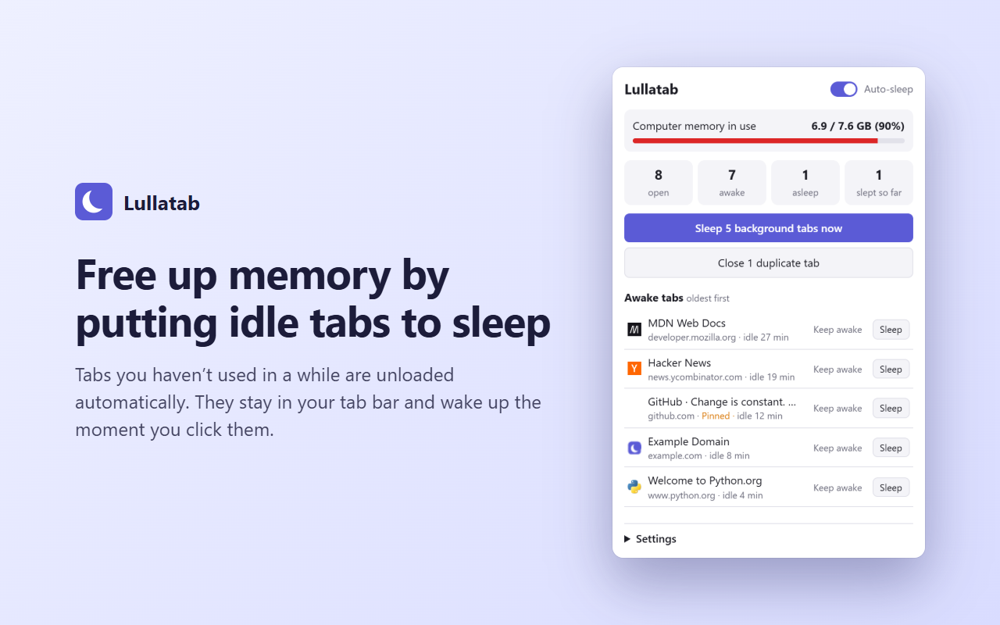

# Lullatab

A free browser extension that cuts memory use by putting tabs you aren't
using to sleep. Works in Chrome, Edge, Brave, Opera, Vivaldi and Firefox.

A sleeping tab stays in your tab bar with its title and icon, but the browser
unloads the page and frees its memory. Click the tab and it reloads. This uses
the browser's own built-in tab discarding (`chrome.tabs.discard`), the same
mechanism Chrome uses when the computer runs low on memory, so no page content
is ever sent anywhere or rewritten.

## What it does

- **Auto-sleep**: tabs you haven't looked at for 30 minutes (adjustable from
  5 minutes to 4 hours) are put to sleep in the background.
- **Sleep all background tabs** with one click.
- **Close duplicate tabs**: finds tabs open on the same page and closes the
  extras, keeping the one you're on (or a pinned one).
- **Memory gauge**: shows how much of your computer's memory is in use, so you
  can see the effect (Chromium browsers only; Firefox has no API for this, so
  the gauge is hidden there).
- **Badge** on the toolbar icon with the number of sleeping tabs.
- Never sleeps the tab you're looking at, pinned tabs, tabs playing audio, or
  sites you mark **Keep awake** (all configurable).

## Install

Store listings for Firefox and Edge are on the way. Until then, install it
from the latest release. It takes about a minute.

### Chrome, Edge, Brave, Opera, Vivaldi (version 121 or newer)

1. Download **[lullatab-chromium.zip](https://github.com/Zion-01/lullatab/releases/latest/download/lullatab-chromium.zip)**
   and unzip it. Keep the unzipped folder somewhere permanent, like your
   Documents folder: the browser loads Lullatab from it every time.
2. Open your browser's extensions page: `chrome://extensions`,
   `edge://extensions`, `brave://extensions`, `opera://extensions` or
   `vivaldi://extensions`.
3. Turn on **Developer mode** (a switch on that page).
4. Click **Load unpacked** and choose the unzipped folder.
5. Click the puzzle-piece icon in the toolbar and pin Lullatab (the moon).

To update later, download the new zip, replace the folder's contents, and
click the reload arrow on Lullatab's card on the extensions page.

### Firefox (version 121 or newer)

Until the Firefox Add-ons listing is live, Firefox can only run Lullatab
temporarily: it's removed when Firefox closes.

1. Download **[lullatab-firefox.zip](https://github.com/Zion-01/lullatab/releases/latest/download/lullatab-firefox.zip)**
   (don't unzip it).
2. Open `about:debugging#/runtime/this-firefox`.
3. Click **Load Temporary Add-on…** and pick the zip file.

### From source

Clone this repository and use **Load unpacked** (Chromium) or **Load
Temporary Add-on…** → `manifest.json` (Firefox) on the cloned folder. Chrome
may note that `background.scripts` is ignored; that entry is for Firefox.

### Safari

Not supported. Safari has no API that lets an extension put a tab to sleep,
which is the core of what Lullatab does. Safari already unloads background
tabs by itself when memory runs low.

## Things to know

- A page that was asleep reloads when you return to it. Unsaved text in a form
  on a sleeping page can be lost, so add sites where you write long things
  (email, docs) to **Keep awake**.
- Browsers don't let extensions read per-tab memory on the stable channel, so
  the gauge shows memory use for the whole computer.
- Idle times reset when you restart the browser.

## Files

| File | Purpose |
| --- | --- |
| `manifest.json` | Extension manifest (Manifest V3), shared by Chromium browsers and Firefox |
| `background.js` | Tracks when each tab was last used and sleeps idle ones every minute |
| `lib.js` | Settings, sleep rules and duplicate detection shared by both scripts |
| `popup.html/css/js` | The toolbar popup |
| `build.py` | Builds the store packages into `dist/` (`python build.py`) |
| `PUBLISHING.md` | Step-by-step guide to listing Lullatab in each store |
| `PRIVACY.md` | Privacy policy for the store listings |
| `store/` | Store description, permission justifications and images |
